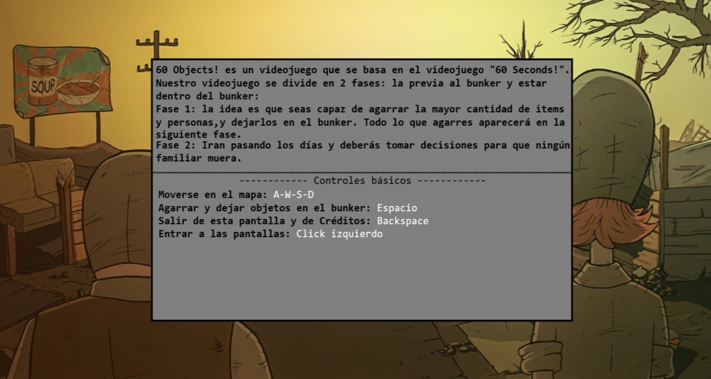
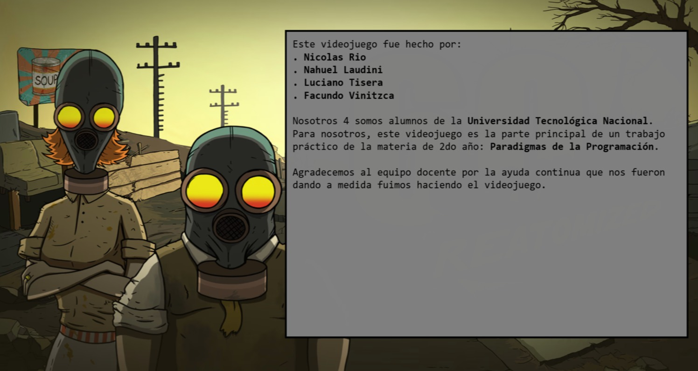

UTN - Facultad Regional Buenos Aires - Materia Paradigmas de Programación

## Equipo de desarrollo:

- Nicolás Ezequiel Rio (NicoRio-ctrl)
- Mariano Nahuel Laudani Rostagno (NahueLaudani)
- Luciano Tisera (SirCabobo)
- Facundo Hernan Vinitzca (ViniBitCode)

## Introducción

**Idea:** El videojuego que proponemos se basa en el videojuego “[60 Seconds!](https://es.wikipedia.org/wiki/60_Seconds!)”.  
**Nombre del juego:** 60 Objects!  
**Descripción:**  
Al iniciar nuestro videojuego, se contará con un menú que permite elegir entre 2 niveles distintos, ver los controles y un tutorial. Iniciado el nivel, el jugador tendrá 20 segundos para explorar el mapa y luego tendrá 60 segundos más para recolectar diferentes personajes e ítems, e ir metiendolos en un búnker. Idealmente, el jugador deberá guardar la mayor cantidad posible de ambos.

Acabados los 60 segundos, se iniciará automáticamente la siguiente fase que se basará en eventos automáticos y aleatorios que tendrán una posibilidad de consumir algunos de los ítems (las sopas y aguas siempre se consumen).  
Perder un evento tiene su propia hoja donde indica cuál ítem hizo que se pierda. Perder un evento implica que se elimine un familiar, y en caso de que no quede ninguno, se pierde el juego.  
Ganar un evento hace que se muestre 1 de 10 imágenes aleatorias con texto de índole graciosa donde se indica que se sobrevivio y nadie fue eliminado.  
La libreta de esta fase tiene 3 páginas: la 1ra es el texto informativo del día, la 2da es una grilla de los ítems hasta ese momento, y la 3ra es una grilla de los familiares junto su estado (vivo o muerto).  
En base a la suerte del jugador, podrá ver 1 de los 3 finales buenos (es decir, de que ganaste), o 1 de los 2 malos (perdiste). Los finales buenos están relacionados con una probabilidad de salir siempre y cuando se tenga un ítem en el refugio. Los finales malos se consiguen se mueren todos los familiares o si se llega al día 15.

Esta es una mera introducción a nuestro videojuego. Invitamos a ver en detalle las mecánicas, ítems, personajes, etc, en el siguiente documento: [Documento Oficial de 60 Objects!](https://docs.google.com/document/d/1SKjEpJtWX55q9Y8NT-3wR65P225o_Xc0/edit?usp=sharing&ouid=116071436523528306350&rtpof=true&sd=true)

## Capturas
### 1er entrega

<table>
  <tr>
    <td width="33%"></td>
    <td width="33%"></td>
    <td width="33%"></td>
  </tr>
  <tr>
    <td></td>
    <td></td>
    <td></td>
  </tr>
  <tr>
    <td></td>
    <td></td>
    <td></td>
  </tr>
</table>

### 3er entrega
<table>
  <tr>
    <td width="33%"></td>
    <td width="33%"></td>
    <td width="33%"></td>
  </tr>
  <tr>
    <td></td>
    <td></td>
    <td></td>
  </tr>
  <tr>
    <td></td>
    <td></td>
    <td></td>
  </tr>
  <tr>
    <td></td>
    <td></td>
    <td></td>
  </tr>
  <tr>
    <td></td>
    <td></td>
    <td></td>
  </tr>
</table>

## Reglas de Juego / Instrucciones

### Instrucciones del juego

Nuestro videojuego se divide en 2 fases: la previa al búnker y la estadía dentro del búnker.  
**Fase 1:** La idea es que seas capaz de agarrar la mayor cantidad de ítems y personas, y dejarlos en el búnker. Todo lo que agarres aparecerá en la siguiente fase.  
**Fase 2:** Irán pasando los días y de manera automática ocurrirán eventos aleatorios que pueden eliminar ítems agarrados en la fase previa. En caso que no se posea el ítem necesario para ganar un evento, se indicará cuál es el mismo y se morirá un familiar. Si no hay familiares vivos (contando al jugador), finalizará la partida.

### Controles:

**Moverse en el mapa:** A-W-S-D  
**Agarrar y dejar objetos en el búnker:** Espacio  
**Retroceder en menú y volver a jugar tras ganar o perder:** Backspace  
**Interactuar en menú y en libreta:** Clic izquierdo

## Explicaciones teóricas y diagramas
### Pantalla
Pantalla define cómo se muestra cada pantalla del juego (mostrar()): limpia assets, pone el fondo, configura los assets y las teclas. imagenFondo() es abstracto (toda pantalla tiene que decir cuál es su fondo), mientras que configurarFondo() y configurarTeclas() tienen una implementación vacía por defecto que cada pantalla redefine si la necesita.
 

### Fase 1
El mapa es una matriz de objetos (x pared, _ piso, i lugar para un ítem). dibujarFondo() recorre la matriz y le manda dibujar(posX, posY) a cada celda sin preguntar de qué tipo es (comportamiento polimórfico de los objetos): la pared y el piso no agregan nada al tablero (están en la imagen de fondo) e i anota su posición para los ítems. El jugador también usa la matriz para saber si puede pasar: nivelCasa.esTransitable(posicion) le pregunta atravesable() a la celda correspondiente.

dibujarObjetos() mezcla ítems y familiares en una sola lista y le manda ponerEn(lugar) a cada uno: los ítems devuelven una copia nueva en esa posición y los familiares se reubican a sí mismos.
 

### Jugador
El jugador delega en su dirección el cálculo de la celda que está mirando: posicionMirada() le manda posicionSiguiente(position) al objeto dirección que tenga guardado. Para agarrar algo, el jugador filtra lo que hay en esa celda con esAgarrable(), así que puede levantar tanto ítems como familiares.
 

### Items y familiares
En el almacén del refugio hay ítems y familiares. Ambos entienden esObjeto(), y así el refugio los separa sin preguntar por su clase: objetosGuardados() y familiaresGuardados() son dos filter sobre la misma lista que maneja el refugio.

ItemConsumible e ItemDurable redefinen ponerEn(posicion) para que la copia sea de su misma clase, y los dos entienden usar() aunque lo resuelven distinto: el consumible siempre se gasta y el durable solo si seRompe().
 

### Libreta (fase 2)
La libreta trata igual a sus tres páginas: a la actual le manda ocultarPagina(), cambia el índice y a la nueva le manda mostrarPagina(). La primera es una Pagina común (solo una imagen enviada por el EventManager); la segunda y la tercera son objetos que heredan de PaginaConIconos, que arma la grilla de íconos y deja abstracto contenidoPagina() para que cada una diga qué mostrar.

Las flechas también son polimórficas para nivelBunker: el click le pregunta a cada una su posición y tamaño, y a la tocada le manda alTocar().
 

### Eventos
Evento es abstracta: no se puede instanciar porque efecto() no tiene implementación. El eventoManager sortea un evento de su lista y le manda efecto(): un evento de eliminación, patearLaCalle o un final responden cada uno a su manera y devuelven el id que define qué libreta mostrar (con ayuda de un diccionario que maneja las imágenes).
 

### Config
configGlobal recorre su lista de reiniciables y les manda reiniciar() a todos (este es el mejor ejemplo donde se ve aplicado el polimorfismo: Los objetos reloj, jugador, inventarioInGame, refugio, i, transicionDias, eventoManager y pantallaFinal son polimórficos para configGlobal respecto del mensaje reiniciar()) Cada uno vuelve a su estado inicial a su manera (el reloj pone el contador en 0, el refugio vacía el almacén, etc.)
 